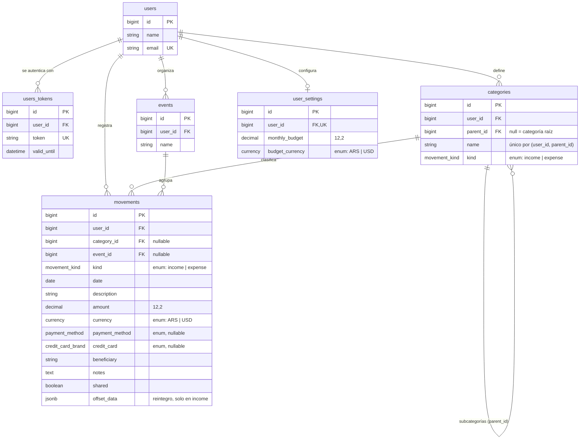

# finances-back

API Rails 7.1 (modo API) + PostgreSQL para una herramienta de seguimiento de gastos personales.
Es el punto de partida de la capacitación de backend: trae la infraestructura armada
(autenticación por token, helpers de render, manejo de errores, RSpec + rswag + FactoryBot)
y solo los modelos `User` y `UsersToken`. El dominio de finanzas se construye siguiendo
[ROADMAP.md](ROADMAP.md).

## Requisitos

- Ruby 3.1.4 (`rbenv`)
- PostgreSQL

## Setup

```bash
eval "$(rbenv init - zsh)"
bundle install
cp .env.example .env          # completar con las credenciales de tu Postgres
bin/rails db:prepare db:seed
```

El seed crea el usuario `demo@finances.test` con el token `dev-token-123!` (no vence),
configurable con `DEV_API_TOKEN`.

## Correr

```bash
bin/rails server -b 0.0.0.0   # 0.0.0.0 para que lleguen el emulador Android y celulares
```

- `GET /up` — health check (sin token)
- `GET /api-docs` — Swagger UI
- El resto de los endpoints exige el header `Authorization: <token>`:
  sin header → `401`, token inexistente o vencido → `403`.

CORS permite cualquier puerto de `localhost` (`config/initializers/cors.rb`) para el front web.

## Datos de volumen

```bash
bin/rails "perf:seed_movements[200000]"   # solo development: 20 usuarios perf-N@finances.test + reintegros
```

Sirve para que `EXPLAIN ANALYZE` muestre planes reales. Con pocas filas Postgres siempre hace Seq Scan.

## Tests y documentación

```bash
bundle exec rspec
bin/rails rswag:specs:swaggerize   # regenera swagger/v1/swagger.json desde los specs de requests
```

## Estructura y convenciones

```
app/controllers/application_controller.rb    validate_token + rescue_from de errores comunes
app/controllers/concerns/rendering_helpers.rb render_object / render_collection / render_error
app/models/application_record.rb             #serialize (ActiveModelSerializers)
app/serializers/                             un serializer por modelo
swagger/definitions/                         schema de cada modelo para rswag (<modelo>_definition)
spec/requests/                               specs de rswag: documentan y testean cada endpoint
spec/shared_contexts|shared_examples/        "with valid token", "requires authorization"
spec/support/requests.rb                     send_request, expect_object_response, schemas
```

Para cada recurso nuevo: migración → modelo + validaciones → factory + spec de modelo →
serializer + spec → swagger definition → controller + ruta → spec de request.

Errores: `RecordInvalid` → `422 invalid_record`, `RecordNotFound` → `404 record_not_found`,
`ArgumentError` → `422 invalid_argument`, con el formato
`{ "response": { "error_name": ..., "error_message": ... } }`.

## Modelo de datos



### Normalización: de dónde venimos

La primera versión de `movements` guardaba la categoría como texto:

| id | user_id | description | category | subcategory |
|----|---------|-------------|----------|-------------|
| 2 | 1 | Alquiler octubre | Vivienda | Alquiler |
| 5 | 1 | Expensas | Vivienda | Expensas |
| 6 | 1 | Alquiler noviembre | vivienda | Alquiler |

- **1FN** (valores atómicos, sin grupos repetidos): se cumplía, porque cada celda tiene un solo valor.
- **2FN** (cada columna depende de toda la clave): se cumplía, porque la clave es `id`, simple.
- **3FN** (sin dependencias transitivas): **no se cumplía**. Que "Alquiler" sea hija de "Vivienda" y que sea un gasto son hechos de la *categoría*, no del movimiento, pero se repetían en cada fila. Eso provoca anomalías:
  - **De actualización:** renombrar "Vivienda" obliga a tocar todos los movimientos, y si se escapa uno quedan dos categorías.
  - **De inserción:** no se puede crear una categoría sin tener un movimiento.
  - **De consistencia:** "Vivienda" y "vivienda" pasan a ser categorías distintas.

Ahora la categoría es una entidad (`categories`) y el movimiento solo guarda `category_id`.

### Decisiones

- **`categories` en tabla propia, por usuario y con `parent_id`.** La taxonomía es configurable por cada usuario, así que la tabla lleva `user_id`. Las subcategorías se resuelven con autorreferencia, con un solo nivel validado en el modelo. El índice único `(user_id, parent_id, name)` con `NULLS NOT DISTINCT` hace que Postgres tampoco acepte dos categorías raíz con el mismo nombre. El movimiento apunta a la categoría más específica (la subcategoría si la tiene) y la raíz se deriva por `parent`. Así se evita guardar `category_id` y `subcategory_id` juntos y que contradigan. Las "categorías aprendidas" del front son simplemente estas filas.
- **`kind` en la categoría y en el movimiento.** Puede parecer duplicado, pero cumplen roles distintos: el del movimiento define el signo del monto y el de la categoría define en qué listas aparece. El modelo valida que coincidan.
- **`events` como tabla.** Un viaje o un cumpleaños tiene identidad propia (nombre, y a futuro fechas o participantes) y agrupa muchos movimientos. Es una relación 1:N opcional, y si se borra el evento el `event_id` queda en `NULL` (`on_delete: :nullify`).
- **`user_settings` 1:1 en vez de columnas en `users`.** Separa la identidad (users) de las preferencias, y las columnas quedan tipadas y validables. La unicidad de `user_id` garantiza el 1:1 en la base.
- **`payment_method` y `credit_card` como listas fijas, no tablas.** No cambian por usuario, así que no ganan nada siendo una tabla. Desde la sesión 5 son enums de Postgres (ver abajo).
- **FKs con `on_delete`.** `cascade` para lo que pertenece al usuario y `nullify` para referencias opcionales (categoría y evento del movimiento). La base mantiene la integridad aunque se borre por fuera de Rails.

### Migraciones reversibles

Todas se pueden revertir con `bin/rails db:rollback`:

| Migración | Cómo revierte |
|-----------|---------------|
| `CreateCategories`, `AddCategoryToMovements`, `CreateEvents`, `CreateUserSettings` | `change`: Rails infiere la inversa (`drop_table`, `remove_reference`). |
| `MoveMovementCategoriesToTable` | `up`/`down` explícitos. Es una migración de datos en SQL que Rails no puede invertir solo: `up` crea las categorías a partir de los strings y llena `category_id`, y `down` reconstruye los strings desde el join. |
| `RemoveCategoryStringsFromMovements` | `change`, pasando el tipo en `remove_column` y las columnas en `remove_index` para que Rails sepa recrearlas. |

Verificado con datos: `db:rollback STEP=6` deja los strings de categoría idénticos a los originales, y volver a migrar reproduce el mismo `schema.rb`. La única diferencia después del rollback es el **orden** de las columnas `category`/`subcategory`, porque Postgres las agrega al final de la tabla. No cambia nada funcional.

## Índices y tipos SQL

Medido con 220.009 movimientos (`perf:seed_movements[200000]`, ~11.000 por usuario). Los planes completos y cómo reproducirlos están en [`docs/explain/session-5.md`](docs/explain/session-5.md).

### Índices de `movements`

| Índice | Por qué |
|--------|---------|
| `(user_id, date)` | Lo usan todas las pantallas: "movimientos del usuario en un mes" y "últimos N del usuario". Filtro por mes: **2,2 ms vs 17,4 ms** sin índice (270 páginas leídas vs 3.430). Últimos 50: **0,05 ms vs 11,3 ms**, porque recorre el índice hacia atrás y corta en 50 sin ordenar toda la tabla. |
| `category_id`, `event_id` | FKs: aceleran el filtro por categoría y los `ON DELETE SET NULL` cuando se borra una categoría o un evento (sin índice, cada borrado recorre toda la tabla). |
| `offset_data` (GIN, `jsonb_path_ops`) | Buscar los reintegros de un gasto con `@>`: **1,9 ms vs 6,0 ms**. `jsonb_path_ops` solo soporta `@>`, pero es más chico y rápido que el operator class por defecto, y es el único operador que usamos. |

**Lo que se sacó o no se creó:**
- **`(user_id)` solo: eliminado.** Es redundante con `(user_id, date)`, porque Postgres usa la primera columna de un índice compuesto como si fuera un índice propio. Medido: con solo `(user_id)`, "últimos 50" tarda 3,0 ms (lee y ordena los ~11.000 movimientos del usuario) contra 0,05 ms con el compuesto. Mantenerlo solo agrega costo en cada INSERT/UPDATE y espacio en disco.
- **`kind`, `shared`, `currency`: sin índice.** Baja cardinalidad: `kind = 'expense'` matchea el 85% de las filas. Con un índice en `kind` creado a propósito, el planner lo ignora y hace Seq Scan igual, porque leer casi toda la tabla por índice es más caro que leerla de corrido.

**Regla:** un índice paga cuando la consulta es frecuente y el filtro es selectivo (devuelve pocas filas sobre muchas). Cada índice extra cuesta en escrituras, y esta tabla se escribe en cada movimiento.

### Enums de Postgres

`kind` (movements y categories), `currency` (movements y user_settings), `payment_method` y `credit_card` pasaron de `string` a tipos enum nativos (`movement_kind`, `currency`, `payment_method`, `credit_card_brand`). Antes solo validaba Rails, y un `update_column`, un SQL a mano o un `insert_all` podían guardar `kind = 'gift'`. Ahora la base responde `invalid input value for enum` (hay test).

- **Enum de Postgres vs `CHECK`:** el enum es un tipo con nombre que se reutiliza (`currency` lo comparten dos tablas) y ocupa 4 bytes. Su contra: agregar un valor es fácil (`ALTER TYPE ... ADD VALUE`, o `add_enum_value` en Rails 7.1+), pero quitarlo o renombrarlo obliga a recrear el tipo. Para listas cerradas que casi no cambian, como estas, el trade-off conviene.
- **Rails sigue declarando el `enum`** (o el `inclusion` de `currency`): da los mensajes de validación y los helpers (`income?`, `payment_method_credit_card?`), mientras la base es la última barrera.
- **La migración tiene `up`/`down` explícitos:** cambiar el tipo de una columna con datos (`USING kind::movement_kind`) no es algo que Rails pueda invertir solo. El default `'ARS'` se saca y se repone alrededor del cambio de tipo, porque Postgres no castea el default automáticamente.

### `offset_data` (jsonb)

Un movimiento `income` puede ser el reintegro de un gasto, de un evento o de una categoría de gastos:

```json
{ "target_type": "movement", "target_id": 12, "amount": "5000.00" }
```

- **Por qué jsonb:** el reintegro apunta a tres tipos de destino distintos, y a futuro puede sumar datos que varían (banco, porcentaje, tope). Con columnas haría falta una FK nullable por cada destino.
- **El costo:** `target_id` no es una FK real. Si se borra el gasto, el reintegro queda apuntando a un id que no existe, y la base no lo impide. Lo cubre el modelo: valida la forma, que solo vaya en `income`, que el monto no supere el del movimiento y que el destino sea un gasto del mismo usuario.
- **Cómo se consulta:** `Movement.offsetting("movement", id)` usa `@>` (servido por el índice GIN) y `Movement.offset_total` suma con `(offset_data->>'amount')::numeric`.
- La creación transaccional del reintegro (guardar el ingreso y actualizar el gasto) queda para la sesión 6.
